# Отчёт по практической работе (homework-5)

**ФИО:** Леонов Тимофей Андреевич<br>
**Группа:** И14-23-9<br>
**Вариант:** 10

PDF-версия отчёта: [`report/ПР5_03.01_Леонов_вариант10.pdf`](report/ПР5_03.01_Леонов_вариант10.pdf)

---

## Ссылки на артефакты

| Блок | Артефакт | Файл |
|---|---|---|
| 1. Цифровой след | C#-контроллер с тегами OpenTelemetry | [`src/Campus.Sports.Api/Controllers/SportsBookingsController.cs`](src/Campus.Sports.Api/Controllers/SportsBookingsController.cs) |
| 1. Цифровой след | Константы и обогащение span'ов | [`src/Campus.Sports.Api/Telemetry/CampusTelemetry.cs`](src/Campus.Sports.Api/Telemetry/CampusTelemetry.cs) |
| 1. Цифровой след | Регистрация OpenTelemetry | [`src/Campus.Sports.Api/Program.cs`](src/Campus.Sports.Api/Program.cs) |
| 1. Цифровой след | Тест наличия тегов | [`tests/Campus.Sports.Tests/TracingTagsTests.cs`](tests/Campus.Sports.Tests/TracingTagsTests.cs) |
| 2. Change Management | Change Request v1.9.0 | [`docs/change-requests/CR-2026-110-v1.9.0.md`](docs/change-requests/CR-2026-110-v1.9.0.md) |
| 2. Change Management | Branch Protection Rules | [`docs/branch-protection.md`](docs/branch-protection.md), [`branch-protection.json`](docs/branch-protection.json) |
| 2. Change Management | CI (обязательные проверки) | [`.github/workflows/homework-5-ci.yml`](../.github/workflows/homework-5-ci.yml) |
| 2. Change Management | Kubernetes Deployment | [`k8s/deployment.yaml`](k8s/deployment.yaml) |
| 3. Expand and Contract | Фаза 1 — Expand | [`db/migrations/01_expand.sql`](db/migrations/01_expand.sql) |
| 3. Expand and Contract | Dual-write в C# | [`src/Campus.Sports.Api/Data/NpgsqlBookingRepository.cs`](src/Campus.Sports.Api/Data/NpgsqlBookingRepository.cs) |
| 3. Expand and Contract | Фаза 2 — Migrate | [`db/migrations/02_migrate.sql`](db/migrations/02_migrate.sql) |
| 3. Expand and Contract | Фаза 3 — Contract | [`db/migrations/03_contract.sql`](db/migrations/03_contract.sql) |
| 3. Expand and Contract | Откат фазы 1 / исходная схема | [`01_expand_rollback.sql`](db/migrations/01_expand_rollback.sql), [`00_baseline_v1.8.sql`](db/migrations/00_baseline_v1.8.sql) |
| 4. Sanity / Docs-as-Code | Production Sanity-тест | [`tests/Campus.Sports.Tests/ProductionSanityTests.cs`](tests/Campus.Sports.Tests/ProductionSanityTests.cs) |
| 4. Sanity / Docs-as-Code | ADR-0009 | [`docs/adr/0009-timeslot-to-timerange.md`](docs/adr/0009-timeslot-to-timerange.md) |
| 4. Sanity / Docs-as-Code | Changelog | [`CHANGELOG.md`](CHANGELOG.md) |

Коммит блока 1: `[CAMPUS-110] Add tracing tags and business logic` — [`8fbed04`](https://github.com/kotokotru/smart-campus/commit/8fbed045e8c0b23976d226309973a792eae44bc6)

---

## Блок 1. Единый цифровой след (Digital Traceability)

В контроллере `SportsBookingsController` в span HTTP-запроса (`Activity.Current`, создан
ASP.NET Core instrumentation) и в дочерний доменный span `SportsBooking.Create` пробрасываются теги:

| Тег | Пример значения | Назначение |
|---|---|---|
| `jira.issue` | `CAMPUS-110` | связь трейса с задачей Jira |
| `campus.booking_id` | `4f1c…e9` | доменный идентификатор брони |
| `campus.facility_id` | `gym-hall-1` | площадка спорткомплекса |
| `campus.time_range.start` / `.end` | `2026-11-05T15:00:00Z` | новый формат интервала |
| `campus.request.format` | `time_range` / `legacy_time_slot` | показывает, сколько клиентов ещё на старом формате |
| `campus.db.migration_phase` | `expand` | текущая фаза миграции |

```csharp
CampusTelemetry.Enrich(Activity.Current, bookingId.ToString(), request.FacilityId);
using var activity = CampusTelemetry.Source.StartActivity("SportsBooking.Create", ActivityKind.Internal);
CampusTelemetry.Enrich(activity, bookingId.ToString(), request.FacilityId);
// внутри Enrich: activity.SetTag("jira.issue", "CAMPUS-110"); activity.SetTag("campus.booking_id", bookingId); ...
```

Цепочка цифрового следа: **Jira CAMPUS-110 → коммит `[CAMPUS-110] …` → CI → образ `1.9.0` →
`kubernetes.io/change-cause` → span с `jira.issue` → строка `schema_migrations` с `jira_issue`**.

## Блок 2. Регламент релиза и Change Management

### Описание заполненного Change Request (CR-2026-110)

* **Релиз:** `campus-sports-api` v1.8.3 → **v1.9.0**, Normal Change, риск средний, простой — 0 мин.
* **Описание:** вводится тип `TimeRange` / `tstzrange` вместо строки `TimeSlot`; выполняются фазы
  Expand и Migrate; API принимает и возвращает оба формата; добавлены теги трассировки и sanity-тест.
* **Бизнес-цель:** исключить двойное бронирование площадок (37 обращений в сентябре → цель 0),
  единое время во всех клиентах (приложение, сайт, турникеты), основа для поиска свободных окон.
* **Окно обслуживания:** **среда 28.10.2026, 03:00–05:00 МСК**. По данным мониторинга это минимум
  трафика (≈ 2 RPS против 180 RPS в пике 17:00–21:00); спорткомплекс закрыт с 23:00 до 07:00;
  ночной бэкап завершается в 02:30; до открытия СК остаётся 2 часа запаса на откат; среда выбрана,
  т.к. в понедельник открывается запись на неделю, а в пятницу нет дежурных на выходных.
* **План работ:** фиксация ревизии → `01_expand.sql` → `kubectl set image` (rolling update,
  `maxUnavailable: 0`) → `kubectl rollout status` → Production Sanity-тест → `02_migrate.sql` →
  проверка трейсов по `jira.issue=CAMPUS-110` → наблюдение 1 час → закрытие CR.
* **План отката:** при 5xx > 1 % за 5 мин, p95 > 800 мс или падении sanity-теста —
  `kubectl rollout undo deployment/campus-sports-api -n campus-sports` и
  `kubectl rollout status …` (≤ 5 мин). Откат БД не требуется: схема после Expand обратно совместима;
  при необходимости — `01_expand_rollback.sql`. Точка невозврата — только `03_contract.sql` в v1.10.0.

### Branch Protection Rules (`main`)

PR обязателен; **2 одобрения**, одно — от Code Owner (DBA для `db/migrations/`); сброс одобрений при
новых коммитах; одобрение последнего push; обязательные проверки **`commit-lint`**, **`build-and-test`**,
**`db-migrations`** при актуальной ветке; разрешение всех обсуждений; подписанные коммиты; линейная
история; запрет force push и удаления; правила обязательны и для администраторов.

## Блок 3. Безопасная миграция БД (Expand and Contract)

| Фаза | Скрипт | Ключевые приёмы |
|---|---|---|
| 1. Expand | `01_expand.sql` | `ADD COLUMN time_range tstzrange` (без DEFAULT — мгновенно), `CHECK … NOT VALID`, функции `parse/format_legacy_time_slot`, триггер синхронизации для подов v1.8, `CREATE INDEX CONCURRENTLY`, `lock_timeout = 3s` |
| 1. Expand (код) | `NpgsqlBookingRepository.CreateAsync` | **dual-write**: одна команда `INSERT` пишет `time_range` (новая структура) и `time_slot` (старая), флаг `Migration:WriteLegacyTimeSlot` |
| 2. Migrate | `02_migrate.sql` | процедура `backfill_time_range`: пакеты по 5 000 строк, `FOR UPDATE SKIP LOCKED`, `COMMIT` после каждого пакета, журнал ошибок, проверка полноты, `VALIDATE CONSTRAINT`; идемпотентна |
| 3. Contract | `03_contract.sql` | предусловия, удаление триггера и `time_slot`, `SET NOT NULL` без сканирования (через валидный CHECK), `EXCLUDE USING gist` против двойного бронирования |

**Проверка на PostgreSQL 16** (локально и в CI, job `db-migrations`), ~46 000 исторических броней:

```
01_expand.sql   — 0.35 s
02_migrate.sql  — batch 10: migrated 1003 … Backfill finished: 46002 rows migrated
                  (строка 'завтра вечером' попала в sports.bookings_migration_errors,
                   скрипт остановился до VALIDATE; после ручного исправления — повторный запуск OK)
                  Verification: time_range IS NULL = 0, unresolved errors = 0, mismatches = 0
03_contract.sql — колонка time_slot удалена, time_range NOT NULL,
                  попытка пересекающейся брони → ERROR: conflicting key value violates
                  exclusion constraint "bookings_no_overlap"
01_expand_rollback.sql — схема возвращена к v1.8, 46 002 строки на месте
```

## Блок 4. Sanity-тестирование и Docs-as-Code

**Production Sanity-тест** `ProductionSanityTests.CreateBooking_InTimeRangeFormat_ThenCleanup`:
создаёт тестовую бронь служебной площадки `sanity-court-00` (заголовок `X-Campus-Sanity: true`) на
15 минут в ночное время случайного дня через год+, проверяет `201 Created`, корректность `start/end`
и заполнение старого поля `timeSlot` (dual-write), чтение через `GET`, `409 Conflict` на дубль;
**Cleanup** в `DisposeAsync` выполняется всегда, даже при падении проверок: `DELETE` (для sanity-брони —
физическое удаление) и контроль `404`. Запуск после релиза:

```bash
SANITY_BASE_URL=https://campus.example/sports/ dotnet test --filter "Category=Sanity"
```

Без `SANITY_BASE_URL` тот же сценарий выполняется in-process (`WebApplicationFactory`) в CI.

**Результат прогона тестов** (`dotnet test`, локально и в GitHub Actions): всего 12, пройдено 12 —
`TimeRangeTests` (10), `TracingTagsTests` (1), `ProductionSanityTests` (1).

**ADR-0009** — обоснование выбора `tstzrange` + exclusion constraint (альтернативы: строка,
две колонки `start_at/end_at`, миграция «big bang»), последствия и точка невозврата.

**CHANGELOG.md** — запись `[1.9.0] - 2026-10-28` по Keep a Changelog: Added, Changed, Deprecated,
Fixed, Breaking Changes (+ анонс breaking changes 1.10.0 в `[Unreleased]`).

---

## Скриншоты

| | |
|---|---|
| Рис. 1. Папка `homework-5` в репозитории | 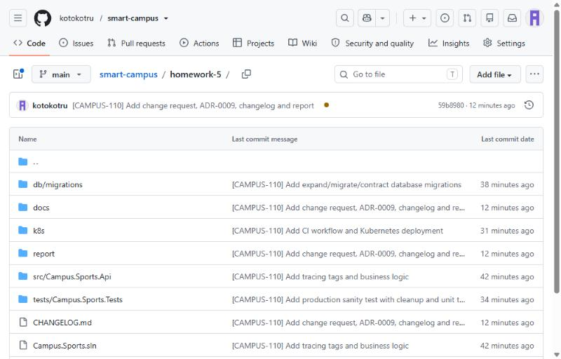 |
| Рис. 2. Теги OpenTelemetry в контроллере | 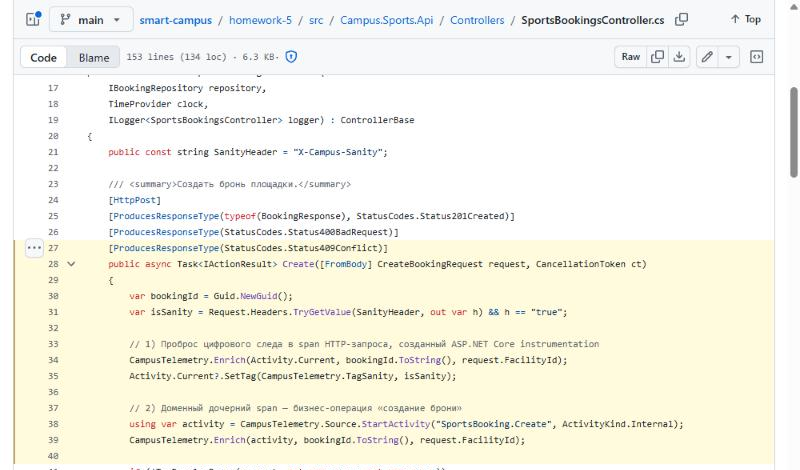 |
| Рис. 3. Коммиты с префиксом `[CAMPUS-110]` | 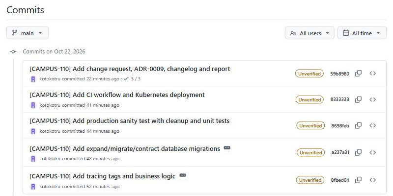 |
| Рис. 4. Карточка CR-2026-110 | 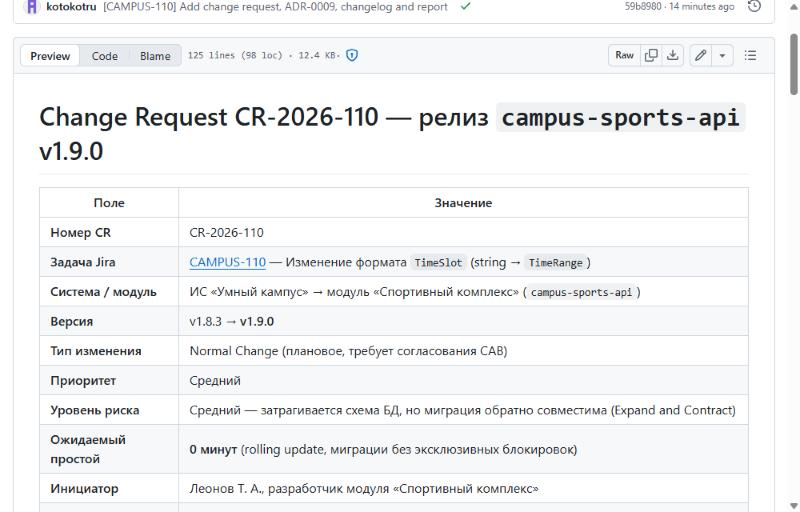 |
| Рис. 5. План отката (`kubectl rollout undo`) | 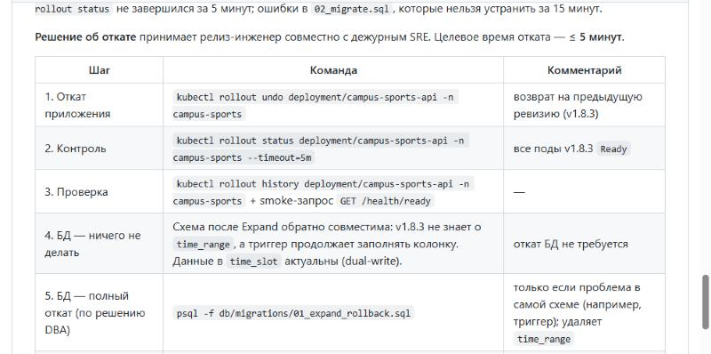 |
| Рис. 6. Обязательные проверки CI пройдены | 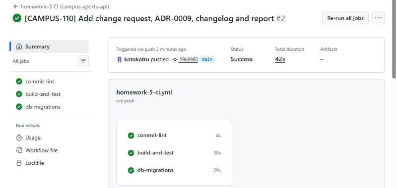 |
| Рис. 7. Фаза Expand (`01_expand.sql`) | 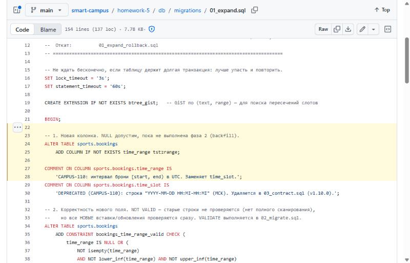 |
| Рис. 8. Dual-write в C# | 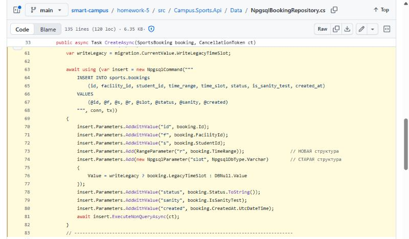 |
| Рис. 9. Выполнение `02_migrate.sql` в CI | 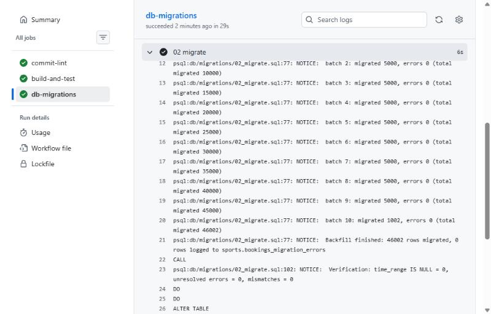 |
| Рис. 10. Cleanup в sanity-тесте | 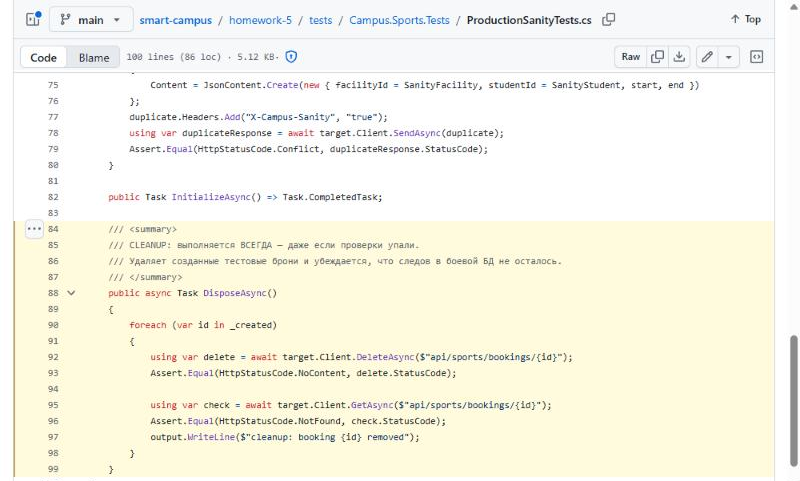 |
| Рис. 11. `dotnet test` на рабочем ПК — 12/12 | 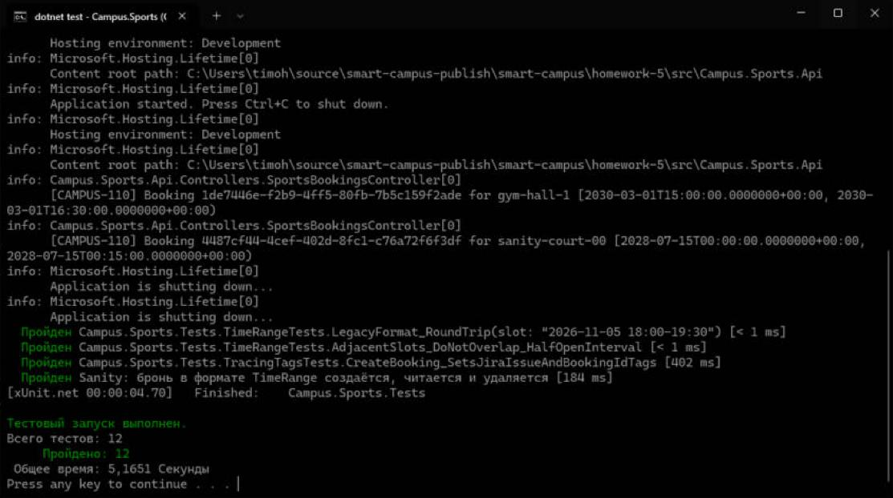 |
| Рис. 12. Тесты в GitHub Actions — 12/12 | 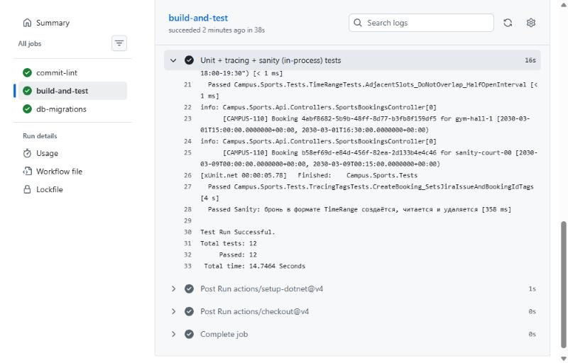 |
| Рис. 13. ADR-0009: альтернативы | 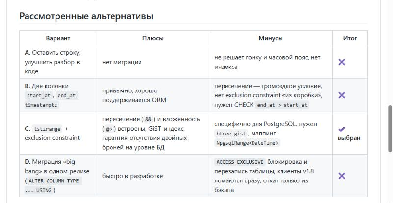 |
| Рис. 14. CHANGELOG: запись 1.9.0 | 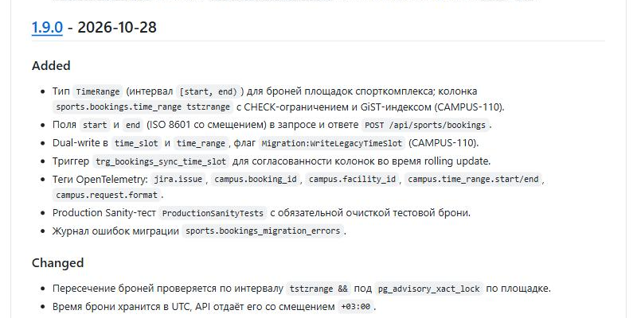 |

## Структура

```
homework-5/
├── REPORT.md · CHANGELOG.md · Campus.Sports.sln
├── src/Campus.Sports.Api/         Controllers · Domain · Data · Telemetry · Program.cs
├── tests/Campus.Sports.Tests/     ProductionSanityTests · TracingTagsTests · TimeRangeTests
├── db/migrations/                 00_baseline · 01_expand (+rollback) · 02_migrate · 03_contract
├── docs/adr/0009-timeslot-to-timerange.md
├── docs/change-requests/CR-2026-110-v1.9.0.md
├── docs/branch-protection.md (+ .json)
├── k8s/deployment.yaml
└── report/  (PDF-отчёт, img/ — скриншоты)
```
