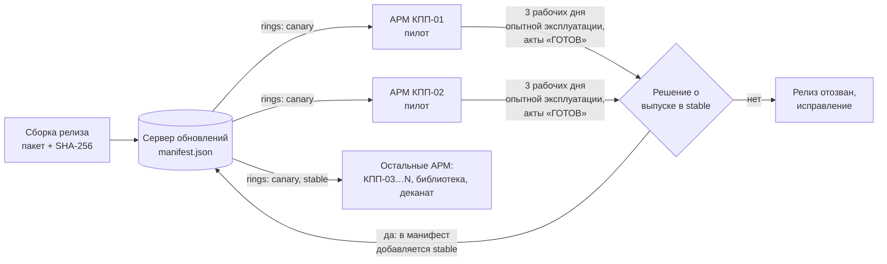

# АРМ оператора ИС «Умный кампус». Инструкция по обновлению (регламент Patch Management)

Документ для системного администратора. Структура соответствует ГОСТ 19.503-79
«Руководство системного программиста». Версия утилиты обновления: **Campus.Arm.Updater 1.0**.
Дата редакции: 24.10.2026.

## 1. Общие сведения

Регламент определяет, как обновления клиентского модуля «АРМ оператора» доставляются с центрального
сервера на распределённые АРМ (КПП, библиотека, деканат), как сохраняются локальные данные,
как проверяется готовность АРМ и как выполняется откат при сбое.

Все шаги автоматизированы консольной утилитой **Campus.Arm.Updater** (C#, .NET 8). Администратор
запускает её вручную или через планировщик заданий Windows; результат каждой операции — запись
в журнале и **акт готовности АРМ** в формате Markdown.

| Компонент | Назначение |
|---|---|
| Сервер обновлений | сетевая папка `\\campus-srv\arm-updates`: `manifest.json` и zip-пакеты версий |
| Манифест | список релизов: версия, кольца развёртывания, путь к пакету, SHA-256 пакета |
| Пакет версии | файлы клиента, `version.json` (версия, версия схемы БД, SHA-256 файлов), SQL-миграции |
| АРМ | слоты `blue`/`green`, файл `active-slot.txt`, локальные данные в `data/` |
| Campus.Arm.Updater | загрузка, проверка, резервная копия, установка, Health Check, откат, акт |

## 2. Структура: схема доставки обновлений

### 2.1. Canary Deployment — кольца развёртывания



- Каждому АРМ в `updater.json` задано кольцо `Ring`: `canary` (2 пилотных АРМ) или `stable` (остальные).
- Новый релиз публикуется в манифесте только для кольца `canary`. АРМ кольца `stable` его **не видят**.
- После 3 рабочих дней опытной эксплуатации без замечаний и при актах «ГОТОВ» с пилотных АРМ
  администратор добавляет в манифест кольцо `stable` — релиз становится доступен всем АРМ.
- Релиз, на котором пилотный АРМ откатился, в `stable` не выпускается.

### 2.2. Blue-Green на каждом АРМ

```
C:\SmartCampus\ARM\
  slots\blue\          версия N   — работает сейчас
  slots\green\         версия N+1 — устанавливается «рядом», не мешая работе
  active-slot.txt      какой слот запускается (blue | green)
  data\appsettings.json, data\cache\, data\campus-local.db   — локальные данные
```

Новая версия устанавливается в неактивный слот, проверяется и только потом становится активной
атомарной заменой `active-slot.txt`. Откат — обратное переключение слота за доли секунды.

## 3. Настройка

Файл `updater.json` рядом с утилитой:

| Параметр | Пример | Описание |
|---|---|---|
| `ArmId` | `ARM-KPP-01` | идентификатор АРМ в журналах и актах |
| `Ring` | `canary` / `stable` | кольцо развёртывания |
| `InstallRoot` | `C:\SmartCampus\ARM` | каталог клиента (слоты и данные) |
| `UpdateSource` | `\\campus-srv\arm-updates` | папка сервера обновлений |
| `BackupRoot` | `D:\ArmBackups` | каталог резервных копий (желательно другой диск) |
| `ReportsRoot`, `LogsRoot` | `C:\SmartCampus\reports` | акты готовности и журналы утилиты |
| `BackupsToKeep` | `5` | сколько последних копий хранить |
| `HealthCheck.ApiUrl` | `https://api.ipify.org?format=json` | API для проверки сетевой доступности |
| `HealthCheck.ApiTimeoutSeconds` / `ApiRetries` | `5` / `3` | таймаут попытки и число попыток (паузы 0,5 → 1 → 2 с) |
| `HealthCheck.DatabaseWarnMs` / `ApiWarnMs` / `ReaderWarnMs` | `200` / `1500` / `500` | пороги задержки, выше — «ПРЕДУПРЕЖДЕНИЕ» |
| `HealthCheck.Reader.Mode` | `Serial` / `Emulator` | реальный считыватель на COM-порту или эмулятор стенда |

## 4. Регламент обновления

### 4.1. Окно обновления

Обновление АРМ КПП выполняется в **00:30–05:30**, когда проход через КПП минимален.
АРМ библиотеки и деканата — после окончания рабочего дня. Оператор смены предупреждается заранее.

### 4.2. Последовательность шагов

| № | Шаг | Что делает утилита | Критерий перехода | При ошибке |
|---|---|---|---|---|
| 1 | Проверка доступности обновлений | `check`: читает манифест, показывает релизы для кольца АРМ | есть релиз выше текущей версии | — |
| 2 | Загрузка пакета | копирует zip с сервера (3 попытки при ошибке ввода-вывода) | файл получен | прерывание, изменений нет (код 3) |
| 3 | Контроль целостности пакета | SHA-256 пакета = SHA-256 в манифесте | совпадает | прерывание, изменений нет (код 3) |
| 4 | Снимок данных | число записей `access_events`, `operators`, `sync_queue` | — | — |
| 5 | Резервное копирование | `appsettings.json`, кэш, онлайн-копия SQLite, проверка SHA-256 копии | копия проверена | прерывание: обновление без копии запрещено |
| 6 | Установка в неактивный слот | распаковка, проверка SHA-256 каждого файла | все файлы совпадают | восстановление данных, слот не переключается (код 2) |
| 7 | Миграции БД | SQL-скрипты пакета, каждый в своей транзакции | версия схемы обновлена | восстановление данных (код 2) |
| 8 | Переключение Blue-Green | атомарная замена `active-slot.txt` | — | — |
| 9 | Health Check | целостность → БД → API → считыватель, задержка каждой проверки | нет проваленных критичных проверок | **автоматический откат** (п. 6.2), код 2 |
| 10 | Акт готовности | `reports/ACT_<АРМ>_<дата>.md` | акт «ГОТОВ» | акт «НЕ ГОТОВ» передаётся разработчикам |

Команда:

```bat
Campus.Arm.Updater update                    :: последняя версия, доступная кольцу АРМ
Campus.Arm.Updater update --version 2.5.0    :: конкретная версия
```

## 5. Резервное копирование локальных данных

| Что копируется | Как | Зачем |
|---|---|---|
| `data\appsettings.json` | копирование файла | настройки АРМ (номер, зона турникета, режим считывателя) |
| `data\cache\*` | копирование каталога | кэш справочников операторов и правил доступа |
| `data\campus-local.db` | онлайн-копия средствами SQLite (`BackupDatabase`) | журнал проходов и очередь синхронизации; копия согласована даже во время записи |

- Копия создаётся **автоматически перед каждым обновлением** в `BackupRoot\<дата>_<время>_v<версия>`.
- В каталоге копии сохраняется `backup.json` с SHA-256 каждого файла. Копия проверяется сразу после
  создания и повторно перед восстановлением; повреждённую копию утилита восстанавливать не будет.
- Хранятся последние `BackupsToKeep` копий (по умолчанию 5), более старые удаляются.

## 6. План отката (Rollback Plan)

### 6.1. Критерии отката

- провал любой критичной проверки Health Check после переключения на новую версию;
- ошибка распаковки пакета или миграции БД;
- жалобы оператора на работу АРМ после обновления, подтверждённые командой `healthcheck`.

### 6.2. Автоматический откат (выполняет утилита)

1. Активный слот возвращается на предыдущую версию (`green → blue`).
2. Локальные данные восстанавливаются из резервной копии, сделанной перед обновлением.
3. Слот с непроверенной версией очищается, чтобы её нельзя было случайно вернуть.
4. Повторный Health Check предыдущей версии.
5. Акт «НЕ ГОТОВ … выполнен откат», код завершения 2.

### 6.3. Ручной откат (выполняет администратор)

1. Убедитесь, что очередь синхронизации передана на сервер (в клиенте: «Завершить смену» → «Синхронизация завершена»).
   События, записанные после создания резервной копии, при откате заменяются данными копии.
2. Выполните:

   ```bat
   Campus.Arm.Updater rollback
   ```

3. Утилита найдёт последнюю резервную копию версии ниже текущей, при необходимости переустановит
   эту версию с сервера обновлений в резервный слот, переключит слот, восстановит данные,
   выполнит Health Check и сформирует акт.
4. Сообщите разработчикам номер версии и приложите акт и журнал `logs\updater-<дата>.log`.

### 6.4. Точки, после которых откат невозможен

Откат невозможен, если на АРМ нет ни одной резервной копии версии ниже текущей или пакет этой версии
удалён с сервера обновлений. Поэтому пакеты версий, выпущенных в `stable`, хранятся на сервере не менее 6 месяцев.

## 7. Проверка готовности АРМ

```bat
Campus.Arm.Updater status        :: версия, слоты, состояние БД
Campus.Arm.Updater healthcheck   :: цепочка проверок и акт готовности
```

| Проверка | Содержание | Порог задержки |
|---|---|---|
| Целостность установки и данных | SHA-256 файлов активного слота, обязательные ключи `appsettings.json`, число записей не меньше, чем до обновления | — |
| Локальная БД SQLite | `PRAGMA integrity_check`, версия схемы и обязательные колонки, пробная запись с откатом транзакции | 200 мс |
| Центральный API | `GET https://api.ipify.org?format=json`, таймаут 5 с, 3 попытки, IP в журнале маскируется | 1500 мс |
| Считыватель карт | чтение тестовой карты, проверка формата UID | 500 мс |

## 8. Сообщения системному администратору

| Код | Значение | Действия |
|---|---|---|
| 0 | операция выполнена, АРМ готов | приложить акт к заявке на изменение |
| 1 | проверки не пройдены (без обновления) | устранить причину по акту (сеть, считыватель, БД) |
| 2 | выполнен откат | передать акт и журнал разработчикам, релиз в `stable` не выпускать |
| 3 | обновление прервано до установки | проверить доступность сервера обновлений и целостность пакета |
| 4 | ошибка настроек | проверить `updater.json` и параметры командной строки |

| Сообщение в журнале | Причина |
|---|---|
| `контрольная сумма пакета … не совпадает с манифестом` | пакет повреждён при передаче или подменён |
| `попытка N/3 неудачна … таймаут` | API не ответил за `ApiTimeoutSeconds` |
| `в БД нет колонки …, необходимой версии …` | ошибка миграции в пакете |
| `Резервная копия повреждена` | диск копий неисправен — восстановление запрещено |
| `Нет резервной копии версии ниже …` | ручной откат невозможен (п. 6.4) |
