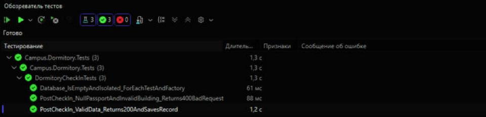
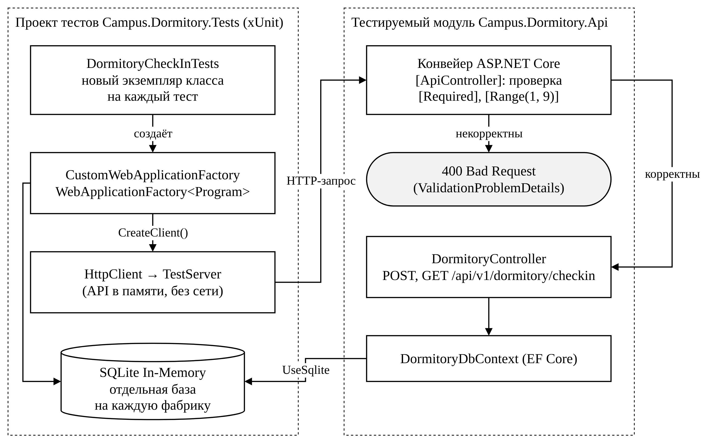

# ОТЧЕТ О ТЕСТИРОВАНИИ ПРОГРАММНОГО ПРОДУКТА

**1. ФИО студента:** Леонов Тимофей Андреевич, группа И14-23-9

**2. Вариант и модуль:** Вариант 10 — «Общежитие и заселение» (`DormitoryCheckIn`), ИС «Умный кампус»

**3. Цель тестирования:** Проверка функциональной пригодности и надежности API (ISO/IEC 25010).

## 4. Итоговая статистика (Test Summary)

| Показатель | Значение |
|---|---|
| Всего тестов | 3 |
| Успешно (Passed) | 3 |
| Провалено (Failed) | 0 |
| Покрытие строк модуля API (coverlet) | 100 % (23 из 23) |
| Статус готовности модуля | **ПЕРЕДАН** |

## 5. Описание выполненных тестов

| № | Тип | Метод | Что проверяется | Результат |
|---|---|---|---|---|
| Тест 1 | Позитивный (Functional Suitability) | `PostCheckIn_ValidData_Returns200AndSavesRecord` | `POST /api/v1/dormitory/checkin` с корректными данными → 200 OK, запись получила `Id`; `GET` возвращает ровно эту запись | Passed (1,2 с) |
| Тест 2 | Негативный (Validation) | `PostCheckIn_NullPassportAndInvalidBuilding_Returns400BadRequest` | `ResidentPassport = null`, `BuildingNumber = 10` → 400 Bad Request, в `ValidationProblemDetails` есть ошибки по обоим полям, запись в базу не попала | Passed (88 мс) |
| Тест 3 | Интеграционный (Isolation) | `Database_IsEmptyAndIsolated_ForEachTestAndFactory` | база теста пуста; запись во второй `CustomWebApplicationFactory` не видна в базе текущего теста (SQLite In-Memory на каждую фабрику) | Passed (61 мс) |

## 6. Скриншот Test Explorer

Схема тестового окружения (draw.io, исходник — [`report/schemes/test_architecture.drawio`](report/schemes/test_architecture.drawio)):

## 7. Заключение (Вывод)

При первом запуске все 3 теста провалились. **Первичная ошибка** — несовместимость версий: проект был собран под .NET 8, а на машине установлен только runtime .NET 10, и приложение запустилось на нём (roll-forward). `SystemTextJsonOutputFormatter` из ASP.NET Core 8 при сериализации ответа выбрасывал `InvalidOperationException: The PipeWriter 'ResponseBodyPipeWriter' does not implement PipeWriter.UnflushedBytes`. **Вторичные симптомы** — падение всех трёх тестов на первом HTTP-запросе: в тесте 1 запись уже была сохранена в базу (`INSERT` выполнен), но вместо ответа 200 тест получил исключение сервера (TestServer пробрасывает его в вызывающий код); в тесте 2 по той же причине не сериализовался ответ 400; тест 3 упал на первом `GET`. Проверки валидации и изоляции к ошибке отношения не имели. После перевода решения на `net10.0` и пакетов 10.0.0 все тесты пройдены.

Риск: NuGet-предупреждение NU1903 — транзитивный пакет `SQLitePCLRaw.lib.e_sqlite3` 2.1.11 имеет известную уязвимость высокого уровня (GHSA-2m69-gcr7-jv3q). Рекомендация — обновить пакет при выходе исправленной версии.

**Вердикт:** модуль «Общежитие и заселение» соответствует требованиям функциональной пригодности и надёжности, ошибки ввода корректно отклоняются кодом 400, тесты изолированы. Модуль **готов к развёртыванию (ПЕРЕДАН)**.

Полный отчёт по требованиям к оформлению: [`report/ПР6_03.02_Леонов_вариант10.pdf`](report/ПР6_03.02_Леонов_вариант10.pdf)
